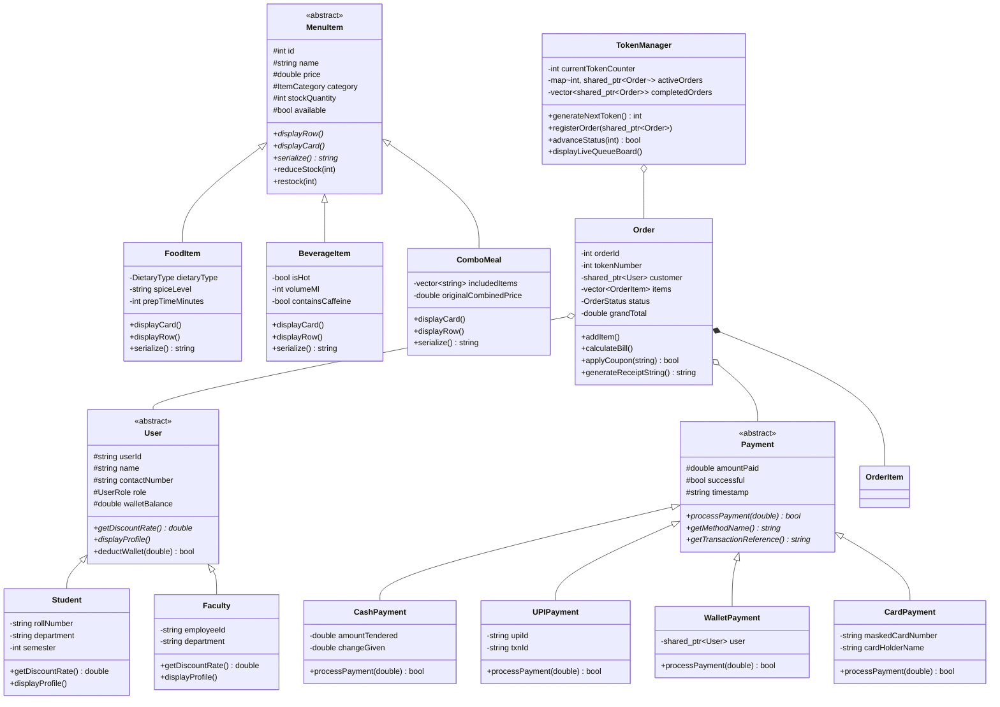

# SmartServe – Smart College Canteen Ordering System 🍽️🎓
> An Object-Oriented C++ application for simplified, organized, and contactless college canteen dining, live digital token queues, and automated billing.

---

## 📌 Project Overview
In typical college canteens, overcrowding during lunch breaks, mismanaged order queues, lost paper tokens, and manual calculation errors cause delays and frustration for students and canteen staff alike.

**SmartServe** solves this problem by delivering a modular, robust C++ application based on **Object-Oriented Programming (OOP)** principles. Students and faculty can view categorized digital menus, filter by dietary requirements, customize quantities, apply coupon discounts, calculate tax invoices automatically, and receive a **unique digital token number** for contactless pickup. Canteen managers can update menus in real-time, restock inventory, and advance orders on a **Live Digital Token Board**.

---

## 🏛️ Object-Oriented Architecture & OOP Pillars

SmartServe was designed from the ground up to showcase the core concepts of Object-Oriented Programming:

### 1. Encapsulation
- All critical class state (`stockQuantity`, `price`, `walletBalance`, `items`, `orderStatus`) is guarded using `private` or `protected` visibility.
- State transitions and data access occur strictly through validated getters, setters, and business methods (e.g., `reduceStock(qty)` checks availability and throws `OutOfStockException` if breached).

### 2. Abstraction
- Complex internal operations (e.g., file serialization, bill taxes, ANSI terminal escape sequences, token dispatching) are hidden behind clear public interfaces (`FileStorage`, `Menu`, `TokenManager`, `UIHelper`).
- Abstract Base Classes (`MenuItem`, `User`, `Payment`) define pure virtual contracts without leaking implementation details.

### 3. Inheritance Hierarchy
- **Menu Hierarchy**:
  - `MenuItem` (Abstract Base)
    - `FoodItem` (Spice level, preparation time, dietary preference)
    - `BeverageItem` (Hot/Cold temperature, volume in ml, caffeine flag)
    - `ComboMeal` (Bundled meals with original price & discounted combo package)
- **User Hierarchy**:
  - `User` (Abstract Base)
    - `Student` (Roll number, semester, 5% student discount privilege)
    - `Faculty` (Employee ID, department, 10% faculty discount privilege)
    - `Admin` (Access credentials for kitchen control and analytics)
- **Payment Strategy Hierarchy**:
  - `Payment` (Abstract Base)
    - `CashPayment` (Amount tendered, change calculation)
    - `UPIPayment` (Simulated QR code, UPI ID, reference verification)
    - `WalletPayment` (Campus SmartCard balance deduction)
    - `CardPayment` (Masked card details, authentication code)

### 4. Polymorphism
- **Runtime Polymorphism (Virtual Functions & Dynamic Dispatch)**:
  - `virtual void displayCard() const = 0;`
  - `virtual void displayRow() const;`
  - `virtual std::string serialize() const = 0;`
  - `virtual double getDiscountRate() const = 0;`
  - `virtual bool processPayment(double amount) = 0;`
  - Virtual destructors across base classes ensuring proper cleanup.
- **Compile-Time Polymorphism (Operator & Function Overloading)**:
  - `operator<<` overloaded for streaming `MenuItem` and `Order` tax receipts.
  - `operator==` overloaded for item comparison.
  - Overloaded search methods (`searchByName`, `getItemById`).

### 5. Exception Handling
- Robust exception hierarchy inheriting from `std::runtime_error`:
  - `CanteenException` (Base)
  - `OutOfStockException`
  - `ItemNotFoundException`
  - `InvalidQuantityException`
  - `PaymentFailedException`
  - `InvalidInputException`

---

## 📊 Class Diagram



---

## 📁 Project Structure

```
Smartserve_canteen_c++OOPs/
│
├── CMakeLists.txt            # CMake build configuration
├── Makefile                  # GNU Make compilation file
├── build.bat                 # One-click Windows build script
├── run.bat                   # One-click launcher script (Console Mode)
├── run_web.bat               # One-click launcher script (Localhost Web Mode)
├── server.py                 # Multi-threaded Localhost Web & API Server
├── README.md                 # Project documentation
│
├── public/                   # Web application frontend
│   └── index.html            # Responsive single-page web application
│
├── bin/                      # Compiled binary folder
│   └── SmartServe.exe        # Main executable
│
├── data/                     # Persistent system storage
│   ├── menu.txt              # Serialized catalog (auto-updated on edits & sales)
│   └── orders_history.txt    # CSV transaction history log
│
├── receipts/                 # Generated printable text invoices
│   └── receipt_TK101.txt     # Formatted receipt for each token
│
├── include/                  # C++ Header files
│   ├── Common.h              # Enums, utility helpers, timestamps, currency
│   ├── Exceptions.h          # Custom exception classes
│   ├── MenuItem.h            # Base abstract class for menu items
│   ├── FoodItem.h            # Food dishes (veg/non-veg, spice level)
│   ├── BeverageItem.h        # Beverages (hot/cold, ml, caffeine)
│   ├── ComboMeal.h           # Meal bundles and student value combos
│   ├── Menu.h                # Menu catalog manager & search
│   ├── OrderItem.h           # Order item wrapper with special notes
│   ├── Order.h               # Cart, bill calculation, tax, coupon logic
│   ├── Payment.h             # Polymorphic payment strategies (Cash, UPI, Wallet, Card)
│   ├── User.h                # Polymorphic user roles (Student, Faculty, Admin)
│   ├── TokenManager.h        # Queue management and live digital display
│   ├── FileStorage.h         # File persistence handler
│   └── UIHelper.h            # Console aesthetics, colors & crash-proof input
│
└── src/                      # C++ Implementation files
    ├── MenuItem.cpp
    ├── FoodItem.cpp
    ├── BeverageItem.cpp
    ├── ComboMeal.cpp
    ├── Menu.cpp
    ├── OrderItem.cpp
    ├── Order.cpp
    ├── Payment.cpp
    ├── User.cpp
    ├── TokenManager.cpp
    ├── FileStorage.cpp
    ├── UIHelper.cpp
    └── main.cpp              # Interactive application entry point
```

---

## ⚡ How to Compile & Run

### Prerequisites
- Any modern C++ compiler supporting C++17 or higher (`g++`, `clang++`, or MSVC).
- Windows PowerShell / Command Prompt or Linux/macOS Terminal.

### Option 1: Running in Localhost Web Mode (Browser UI)
To launch the system on localhost with the interactive web interface:
```cmd
.\run_web.bat
```
*(or run `python server.py 8080`)*
Then open your browser at:
**[http://localhost:8080](http://localhost:8080)**

### Option 2: Running in Native Console Mode (Interactive CLI)
Simply double click or run:
```cmd
build.bat
run.bat
```

### Option 3: Using standard `g++` directly
```bash
g++ -std=c++17 -Wall -Iinclude src/*.cpp -o bin/SmartServe.exe
.\bin\SmartServe.exe
```

### Option 3: Using GNU Make
```bash
make
make run
```

### Option 4: Using CMake
```bash
mkdir build
cd build
cmake ..
cmake --build .
```

---

## 🚀 Key Features Walkthrough

### 1. 🎓 Student & Faculty Portals
- **Role Privileges**:
  - **Students**: 5% automatic campus discount.
  - **Faculty**: 10% institutional privilege discount.
- **Dietary Filtering**: Filter between Vegetarian `[V]`, Non-Vegetarian `[N]`, and Vegan `[L]`.
- **Search**: Instant substring search for dishes and drinks.
- **Item Customization**: Add special instructions like *"Extra spicy"*, *"No ice"*, or *"Crispy"*.
- **Promo Coupons**:
  - `CAMPUS50`: Flat Rs. 50 off on orders >= Rs. 200.
  - `WELCOME10`: 10% extra discount on total bill.
  - `SNACK5`: Flat Rs. 5 off on quick bites.

### 2. 💳 Payment Methods
- **Cash at Counter**: Tracks amount tendered and computes exact change.
- **UPI QR Scan**: Simulates instant BHIM/UPI verification with reference ID.
- **Campus SmartCard / Wallet**: Seamless prepaid dining deduction with instant balance inquiry.
- **Debit / Credit Card**: Validates format, masks card number, generates auth code.

### 3. 🎫 Automated Token System & Live Queue Board
- Assigns sequential token numbers (`TK-101`, `TK-102`, ...).
- Dynamically estimates preparation time based on quantity and complexity.
- Real-time digital board categorizes orders into:
  - `[ IN KITCHEN / PREPARING ]`
  - `[ READY FOR PICKUP AT COUNTER ]` (High-visibility pickup alert)
  - `[ RECENTLY COMPLETED ]`
- Customer Token Tracker allows lookup of exact order status and remaining wait time.

### 4. 👨‍🍳 Canteen Admin & Kitchen Management (Passcode: `admin123`)
- **Queue Dispatcher**: Kitchen staff can advance orders:
  $$\text{Placed} \longrightarrow \text{Preparing} \longrightarrow \text{Ready for Pickup} \longrightarrow \text{Delivered}$$
- **Menu Catalog Editor**: Add new food, beverages, and combo meals; modify prices; toggle stock availability.
- **Sales & Revenue Analytics**: Generates live business intelligence metrics:
  - Total gross revenue.
  - Total orders processed.
  - Student vs Faculty breakdown.
  - Order transaction log.

### 5. 🧾 Printable Invoices & Data Persistence
- Full tax invoices are printed to console and saved as text files under `receipts/receipt_TK<token>.txt`.
- Menu modifications and inventory decrements persist in `data/menu.txt`.
- Order logs append to `data/orders_history.txt`.

---

## 🧪 Sample Receipt Output

```text
=================================================================
              SMARTSERVE COLLEGE CANTEEN SYSTEM                 
                   TAX INVOICE & ORDER TOKEN                     
=================================================================
 Order ID:       #1001
 Token Number:   >>> [ TK-101 ] <<<
 Order Status:   Order Placed
 Date & Time:    2026-11-05 20:18:06
 Customer:       Rahul Sharma (Student)
 Contact No:     9876543210
-----------------------------------------------------------------
 Qty | Description                     | Unit Price | Total Price
-----------------------------------------------------------------
   1 | Masala Dosa                     |      60.00 |      60.00
     Note: "Crispy"
   1 | Thick Cold Coffee w/ Cream      |      55.00 |      55.00
-----------------------------------------------------------------
 Subtotal:                                            Rs. 115.00
 Privilege Discount (Student):       -        Rs. 5.75
 Promo Code (WELCOME10):                  -       Rs. 10.93
 Canteen GST (5%):                                      Rs. 4.92
-----------------------------------------------------------------
 FINAL AMOUNT PAYABLE:                                Rs. 103.24
=================================================================
 Payment Method: UPI / QR Payment
 Transaction ID: UPI100041REF
 Payment Status: PAID & VERIFIED
 Est. Pickup Time: ~9 minutes from order placement
 Please watch the Live Digital Token Board for 'TK-101'!
=================================================================
        Thank you for choosing SmartServe Canteen System!        
=================================================================
```

---

## 📜 Academic Merit & OOP Evaluation Highlights
| Concept | Implementation in SmartServe |
| :--- | :--- |
| **Classes & Objects** | Separate classes for Menu, Items, Orders, Users, Payments, Tokens, and Files |
| **Encapsulation** | Private attributes with boundary checks and validated setters |
| **Inheritance** | Base `MenuItem` $\rightarrow$ `FoodItem`, `BeverageItem`, `ComboMeal`; Base `User` $\rightarrow$ `Student`, `Faculty`, `Admin` |
| **Polymorphism** | Pure virtual methods in abstract classes, virtual destructors, dynamic method resolution |
| **Operator Overloading** | Overloaded `operator<<` for printing items and streaming formatted receipts |
| **Exception Handling** | Custom hierarchy (`OutOfStockException`, `PaymentFailedException`, etc.) |
| **File Handling & STL** | `fstream`, `std::vector`, `std::map`, `std::shared_ptr`, `<iomanip>`, `<chrono>` |

---

## 👩‍💻 Developed For
College Canteen Dining Automation & Academic Object-Oriented Programming (OOP) Demonstration.
